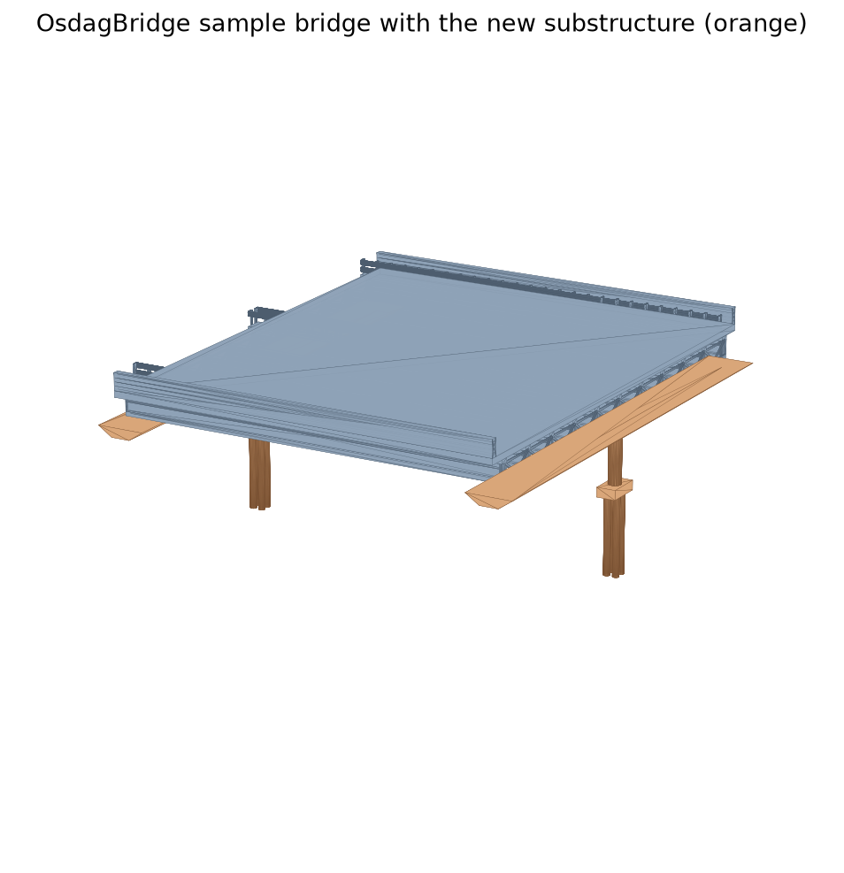
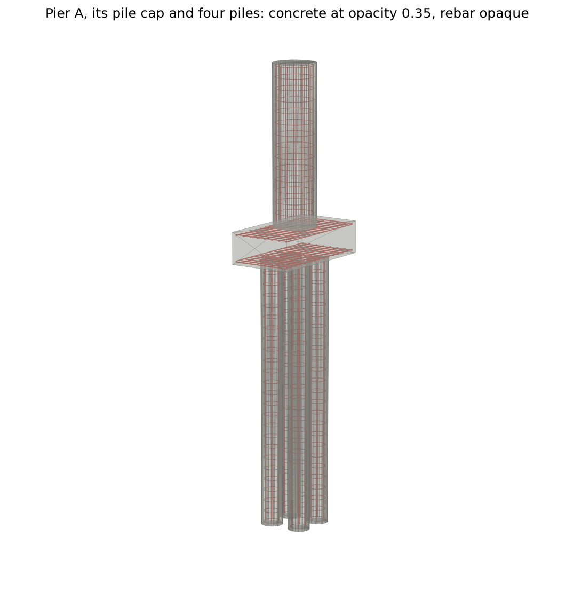

# Substructure 3D CAD and IFC integration (FOSSEE screening task)

OsdagBridge models and exports the superstructure of a plate girder bridge,
but its substructure modules were empty stubs and the `.ifc` export contained
the superstructure only. This branch adds a parametric pier cap, circular
pier, pile cap and 2 x 2 pile group with reinforcement under both bearing
lines, shows them in the 3D window (concrete at opacity 0.35, rebar opaque),
and writes them into the existing IFC export next to the superstructure.




## File structure

```
src/osdagbridge/core/bridge_components/
├── sub_structure/
│   ├── solids.py            Box, Cylinder, PrismY and Bar with exact volumes;
│   │                        fillet_polyline (bent rebar), circle_points (hoops)
│   ├── substructure.py      SubstructureParams (task dimensions), bearing_lines,
│   │                        build_substructure: assembles each support line
│   ├── builder.py           build_substructure_cad: model -> pythonOCC shapes
│   ├── rebar_builder.py     pythonOCC sweep of a bar along its axis
│   ├── pier/                geometry.py (circular pier + cage), builder.py (pythonOCC),
│   │                        checks.py
│   └── pier_cap/            geometry.py (trapezoidal cap + bars, stirrups),
│                            builder.py (pythonOCC)
└── foundation/
    ├── pile/                geometry.py (2 x 2 grid, pile cage), builder.py, checks.py
    └── pile_cap/            geometry.py (block + top/bottom mats), builder.py

src/osdagbridge/core/bridge_types/plate_girder/cad_generator.py
                             STEP 12: _build_substructure() adds pier_caps, piers,
                             pile_caps, piles, substructure_rebar to model_data
src/osdagbridge/desktop/ui/cad_3d.py
                             displays them (transparency 0.65 = opacity 0.35),
                             "Substructure" checkbox in the component panel
src/osdagbridge/core/ifc_export_bridge/
├── bridge_cad_extraction.py _extract_substructure(): same model for the export
├── bridge_ifc_generator.py  calls SubstructureIfcWriter after the superstructure
├── substructure_ifc.py      IFC4 writer (classes, materials, psets, quantities)
├── bridge_geometry_mapper.py  fix: mandatory ReflectanceMethod in colours
└── ifc_selfcheck.py         re-opens the .ifc and verifies it

tests/substructure/          18 tests (geometry, export, schema, mutation tests)
tools/substructure_demo.py   export the sample bridge to .ifc without the GUI
tools/render_ifc.py          the pictures above
```

## Dimensions (from the task, all in `SubstructureParams`)

| Member | Default |
|---|---|
| Pier (circular) | diameter 800, height 3000 |
| Pier cap (trapezoid) | top width 3000, bottom width 1200, depth 600, length = deck width |
| Pile cap | 2200 (across) x 1200 (along span) x 600 |
| Piles | 4 in a 2 x 2 grid, diameter 400, length 5000, spacing 600 c/c |
| Rebar | main 16 @ 150, transverse 8 @ 200, cover 40 |

Pass your own with `design_params.substructure_params = SubstructureParams(...)`,
or switch the substructure off with `design_params.include_substructure = False`.

## Coordinate system

X along the span, Y across the deck, Z up, as for the existing superstructure.
The bearing lines are found with the same formulas as the existing supports
(`bearing_lines` in substructure.py), so the pier cap top meets the bearing
underside at both ends of the span.

## IFC output

| Member | IFC4 class |
|---|---|
| Pier cap | `IfcBeam`, ObjectType `PIERCAP` |
| Pier | `IfcColumn`, ObjectType `PIER` |
| Pile cap | `IfcFooting`, `PILE_CAP` |
| Pile | `IfcPile`, `BORED` |
| Bars | `IfcReinforcingBar` (`MAIN` / `LIGATURE`), aggregated by their member |

Each member has a material (`Concrete M35`, `Steel Fe500`),
`Pset_ConcreteElementGeneral` (strength class, cover), `Pset_OsdagSubstructure`
(shape, dimensions, design volume) and a `NetVolume` quantity, which is what a
BIM tool's bill of quantities reads. Each bearing line is an
`IfcElementAssembly` in a **Substructure** storey beside **Superstructure**.
The file passes `ifcopenshell.validate` with no schema errors.

## Self-check

```
python -m osdagbridge.core.ifc_export_bridge.ifc_selfcheck bridge.ifc
```

Re-opens the file and checks, from the file alone: (1) each member's volume
against its design volume, (2) members stacking face to face, (3) every bearing
landing on a pier cap, (4) every bar keeping its cover, (5) no clashes between
members or between bars. On the sample bridge: 14 members, 750 bars, all pass.

## Running

```
conda activate osdagbridge-env
cd src
python -m osdagbridge.desktop        # design, then the 3D view; File > Save 3D CAD Model > .ifc
cd ..
python -m pytest tests/substructure -q
python tools/substructure_demo.py out/bridge.ifc
python -m osdagbridge.core.ifc_export_bridge.ifc_selfcheck out/bridge.ifc
```

## Limits

- Geometry, not structural design: dimensions are the task defaults, not
  sized from loads.
- The pier cap is laid square to the span; on a skewed deck the self-check
  reports bearings that fall off the cap.
- The task's 600 mm pile spacing is 1.5 x the 400 mm diameter; the pile check
  notes it is below the usual 3 x diameter.
