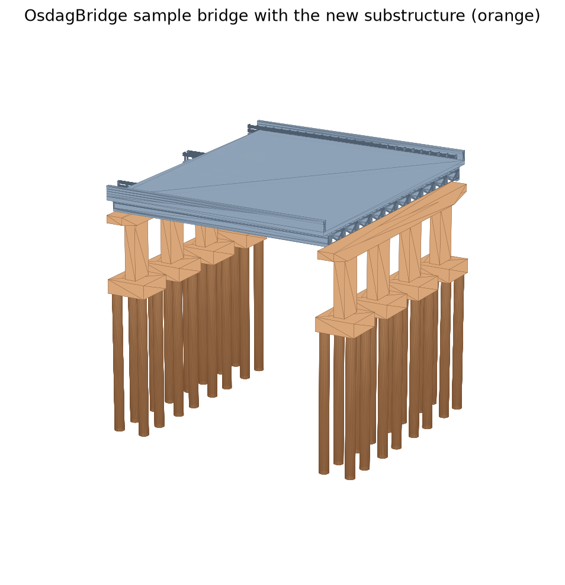
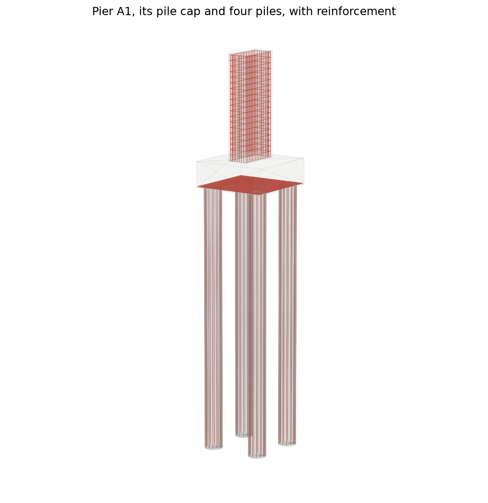
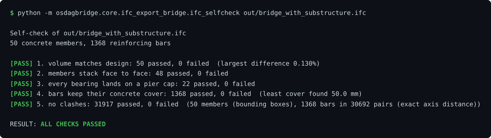

# Substructure 3D CAD and IFC export

OsdagBridge designs the superstructure of a plate girder bridge and exports it
to IFC, but the bridge stood on nothing: the `pier`, `pier_cap`, `pile` and
`pile_cap` modules were one-line stubs and the IFC file had no substructure.
This work fills those modules and adds the substructure to the IFC export,
placed under the bearings that the existing extractor already computes, with
a self-check that re-opens the exported file and verifies it.



## What gets built

Under each bearing line (both ends of the span), top to bottom:

| Member | Shape | IFC class | Reinforcement |
|---|---|---|---|
| Pier cap | flat top, deep over the columns, tapering to the tips | `IfcBeam`, ObjectType `PIERCAP` | top bars across the bridge |
| Pier column(s) | rectangular | `IfcColumn`, ObjectType `PIER` | longitudinal bars + bent ties |
| Pile cap | rectangular block | `IfcFooting`, `PILE_CAP` | two-layer bottom mat |
| Piles | circular, 2 x 2 group | `IfcPile`, `BORED` | ring of longitudinal bars |

A narrow deck gets one column (a hammerhead pier). A deck wider than
`max_column_spacing` (7 m) gets more columns, each with its own pile cap and
piles, because one column under a 28 m cap is not a sensible structure.



Every member carries in the IFC file:

- its **material** (`Concrete M35`, `Steel Fe500`) through `IfcRelAssociatesMaterial`;
- `Pset_ConcreteElementGeneral` with `StrengthClass` and `ConcreteCover`;
- `Pset_OsdagSubstructure` with its shape, dimensions and **design volume**;
- a base quantity set with `NetVolume`.

Bars are `IfcReinforcingBar` (`MAIN` or `LIGATURE`) with diameter, area and
length, aggregated by the member that holds them. Each bearing line is an
`IfcElementAssembly` in a new **Substructure** storey beside the existing
**Superstructure** storey.

## How it fits into OsdagBridge

```
PlateGirderIFCExtractor.extract()
  ├─ girders, stiffeners, bracing, deck, barriers   (existing)
  ├─ supports                                        (existing: bearing geometry)
  └─ substructure  ← _bearing_lines() → build_substructure()        (new)

BridgeIfcGenerator.generate_from_extracted_data()
  ├─ superstructure entities                         (existing)
  └─ SubstructureIfcWriter.write()                   (new)
```

| File | Role |
|---|---|
| `core/bridge_components/sub_structure/solids.py` | Box, Cylinder, PrismX and Bar with exact volumes; `fillet_polyline` bends rebar corners |
| `core/bridge_components/sub_structure/pier_cap/geometry.py` | pier cap (was a stub) |
| `core/bridge_components/sub_structure/pier/geometry.py`, `checks.py` | pier column, bars and ties (were stubs) |
| `core/bridge_components/foundation/pile/geometry.py`, `checks.py` | pile group, pile cages, 3D spacing rule (were stubs) |
| `core/bridge_components/foundation/pile_cap/geometry.py` | pile cap and bottom mat (was a stub) |
| `core/bridge_components/sub_structure/substructure.py` | `SubstructureParams` and assembly under each bearing line |
| `core/bridge_components/sub_structure/occ_builder.py` | the same model as pythonocc shapes for the Osdag 3D view |
| `core/ifc_export_bridge/substructure_ifc.py` | IFC4 writer |
| `core/ifc_export_bridge/ifc_selfcheck.py` | re-opens the IFC and verifies it |
| `core/ifc_export_bridge/bridge_cad_extraction.py` | `_bearing_lines`, `_extract_substructure` added |
| `core/ifc_export_bridge/bridge_ifc_generator.py` | calls the writer |

One model feeds both the IFC writer and the pythonocc builder, so the 3D view
and the exported file cannot disagree.

Proportions come from `SubstructureParams` (pier height, column size, pile
diameter and length, cover, bar sizes and spacings). A design can pass its own
through `cad.substructure_params`, or turn the substructure off with
`cad.include_substructure = False`.

## The self-check

```
python -m osdagbridge.core.ifc_export_bridge.ifc_selfcheck bridge.ifc [report.json]
```

It reads only the IFC file: the design intent stored in the property sets on
one side, and the geometry rebuilt by IfcOpenShell's OpenCASCADE kernel or
read from the bar sweeps on the other.



| Check | How |
|---|---|
| 1. Volume matches design | kernel volume vs `DesignVolume` (0.5 %, 1 % for tessellated cylinders); piles also against pi r² L |
| 2. Members stack face to face | cap soffit = pier top, pier bottom = pile cap top, pile tops = pile cap underside, footprints inside (2 mm) |
| 3. Every bearing lands on a cap | each bearing's own (x, y) inside the cap plan, cap top at the bearing underside |
| 4. Bars keep their cover | exact extent of each swept bar inside its member, at least the stated cover |
| 5. No clashes | members may touch but not interpenetrate; bars in a member never cross (exact segment-to-segment distance of the bar axes) |

On the sample bridge (25 m span, 11 girders): 50 members, 1,368 bars, all
five checks pass; the largest volume difference is 0.13 % (tessellated piles).

## Tests

```
pip install ifcopenshell pytest numpy
python -m pytest tests/substructure -q
```

17 tests. Besides geometry checked by hand (pile volume, pier cap area, column
count, bent tie corners) and the real export path, five **mutation tests**
damage the exported file in one way each (shrink a pile, sink a pile, push a
bar into the cover, push one bar layer into the other, move a bearing) and
assert the self-check catches exactly that. A skewed deck test confirms that
bearings missing a square cap are reported, not hidden.

pythonocc is only installable with conda. When it is missing (CI), the tests
use a stand-in so that modules which import it at the top still load; the
export path itself never calls it.

## Running it

```
python tools/substructure_demo.py out/bridge_with_substructure.ifc
python -m osdagbridge.core.ifc_export_bridge.ifc_selfcheck out/bridge_with_substructure.ifc
python tools/render_ifc.py out/bridge_with_substructure.ifc docs/images
python tools/view_substructure_occ.py          # pythonocc window (Osdag conda env)
python tools/view_substructure_occ.py --check  # OpenCASCADE volumes, no window
```

The desktop **Export IFC** button uses the same path, so its files now include
the substructure.

## Limits, stated plainly

- **This is geometry, not structural design.** The default proportions are
  typical for a short-span highway pier; they are not computed from loads.
  Sizing them from the design forces (IRC 6 / IRC 112) is the next step.
- **Skew:** the pier cap is laid square to the span. On a skewed deck the
  self-check reports the bearings that fall off the cap (see the skew test).
- **Pile heads** stop at the pile cap underside; no embedment is modelled.
- The **pythonocc builder** is written against pythonocc 7.x and checked by
  `tools/view_substructure_occ.py --check`; the 3D view in the desktop app does
  not show the substructure yet.
